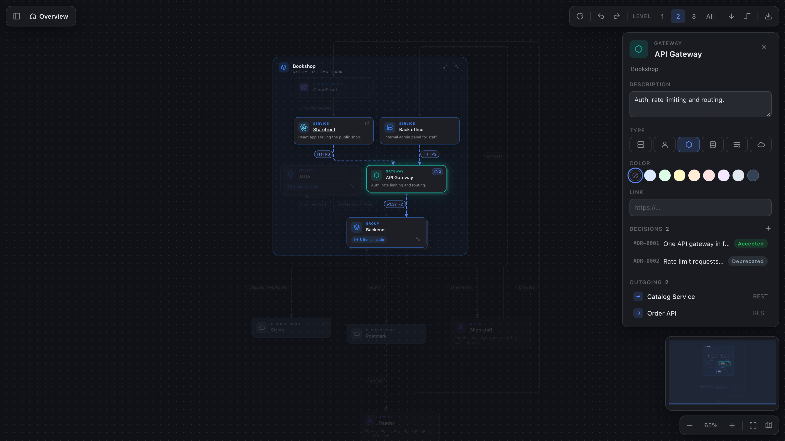
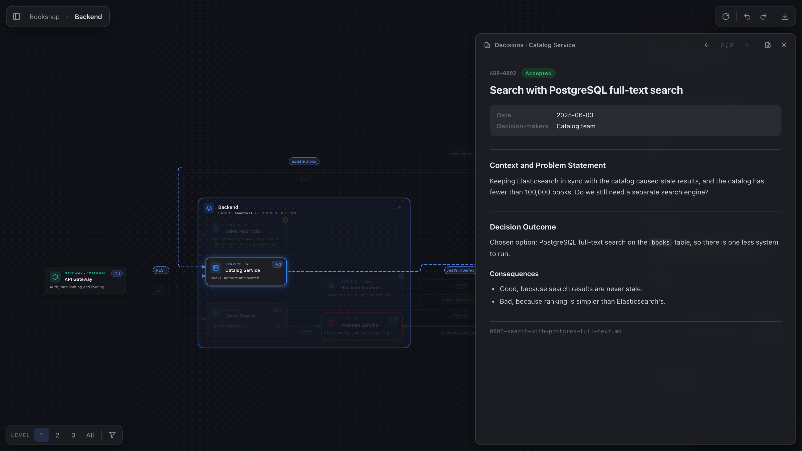

<div align="center">


# mapitect

**Your architecture as code, explored as a map.**

mapitect turns plain-text [D2](https://d2lang.com) diagrams into interactive architecture maps:<br>
zoom from the system landscape down to single services, edit right in the diagram,<br>
and read the decisions behind every component, without leaving your editor.

[What it is](#what-is-mapitect) · [Features](#features) · [Getting started](#getting-started) · [Development](#development)

<br>



</div>

## What is mapitect?

Architecture diagrams usually live in drawing tools: nice to look at, but out of date the week after they're drawn, impossible to review in a pull request, and flat. One picture has to show everything at once.

mapitect keeps the model where it belongs, in a `.d2` text file next to your code, and gives it a proper viewer:

- **One file, many levels.** Write the whole system once with nested containers. mapitect shows it like a C4 map: start with the landscape, then drill into a system, a container, a service. Connections into collapsed groups are merged, so every level stays readable.
- **Text stays the source of truth.** Renaming an element, changing its description, type or color in the diagram becomes a small, targeted edit in the `.d2` file. Your formatting and comments are kept, and the change shows up in your diff like any other.
- **Lifecycle on the map.** Mark elements as `future` or `deprecated` with `vars: {status: …}`. They get a status badge, and a filter switches between the current and the target architecture.
- **Decisions live with the components.** Point mapitect at your [MADR](https://adr.github.io/madr/) decision records and each element shows the decisions that shaped it, readable right next to the map.
- **Real D2.** The official D2 compiler (WASM) parses the file, so classes, vars, globs and imports work exactly as they do in `d2` itself.

```d2
shop: Bookshop {
  web: Storefront { tooltip: React app serving the public shop. }
  gateway: API Gateway { shape: hexagon }
  backend: Backend {
    orders: Order Service
    payments: Payment Service
  }
  web -> gateway: HTTPS
  gateway -> backend.orders: REST
}
customer: Reader { shape: person }
customer -> shop.web: browses
```

The [example](examples/platform.d2) is a small online bookshop that uses every feature; open it to get a feel for mapitect.

## Features

<table>
<tr>
<td width="50%" valign="top">

### 🧭 Navigate
- **Detail levels** 1 / 2 / 3 / All collapse nested containers
- **Drill down** into any container, with the elements it talks to kept as context
- **Zoom, pan, minimap** and semantic zoom that fades details out as you zoom away
- **Search** and a model tree of the whole hierarchy
- **Selection highlighting** that traces an element's connections
- **Status filter** to show the current state, the target state or only what changes

</td>
<td width="50%" valign="top">

### ✏️ Edit
- **Rename** elements and connection labels inline (`F2` or double-click)
- **Details panel** for description, link, type, lifecycle status and fill color
- **Layout direction** right / down / left / up, written back to the file
- **Undo / redo** for visual edits
- Structure stays in the code: adding or rewiring elements is done in the `.d2` file

</td>
</tr>
<tr>
<td width="50%" valign="top">

### 🔗 Stay in sync with the source
- **Live preview** that re-renders and animates as you type
- Selecting an element **highlights its declaration** in the editor, and the element under your cursor is outlined in the map
- `Cmd/Ctrl+click` jumps to the source
- Compiler errors as diagnostics; the last valid diagram stays visible

</td>
<td width="50%" valign="top">

### 📜 Architecture decisions
- Badges with the number of **ADRs per element**
- A **decision reader** with status, date and decision-makers
- **New decision…** creates the next numbered MADR file for an element
- Decisions from several folders are merged per element and update live

</td>
</tr>
</table>

<br>

<div align="center">

<br><sub>The decision reader: the record behind the selected component, next to the map.</sub>
</div>

<br>

Everything follows the VS Code light, dark and high-contrast themes, and diagrams export to SVG or PNG. The full feature list, keyboard shortcuts, settings and the ADR folder conventions are in the [extension's README](packages/vscode/README.md).

## Getting started

mapitect currently ships as a VS Code extension. Build and install it from this repository:

```bash
npm install
npm run package
code --install-extension packages/vscode/mapitect-0.1.0.vsix
```

Then open [`examples/platform.d2`](examples/platform.d2) and press `Cmd+K V` (`Ctrl+K V` on Windows and Linux), or click the preview button in the editor title bar.

To attach decision records to a diagram, list their folders in the `adr-folders` variable. Each folder has one subfolder per element:

```d2
vars: {
  adr-folders: [adr; ../shared/decisions]
}
```

## Development

```bash
npm install
npm run build      # bundles the extension, its webview and the dev harness; copies the D2 WASM runtime
npm test           # core tests against the real compiler, plus an extension-host smoke test
npm run typecheck  # every package against only the APIs it may use
npm run package    # produces packages/vscode/mapitect-<version>.vsix
```

Press `F5` in VS Code to start an Extension Development Host with `examples/` open.

To iterate on the UI in a plain browser, run `npm run dev` (or `node packages/dev/server.mts` after a build) and open `http://localhost:5317/`. The server runs the real core session against an in-memory copy of a file from `examples/` and never writes to disk. Add `?theme=light` or `?file=<name>.d2` to change the theme or the example file.

## License

[MIT](LICENSE)
