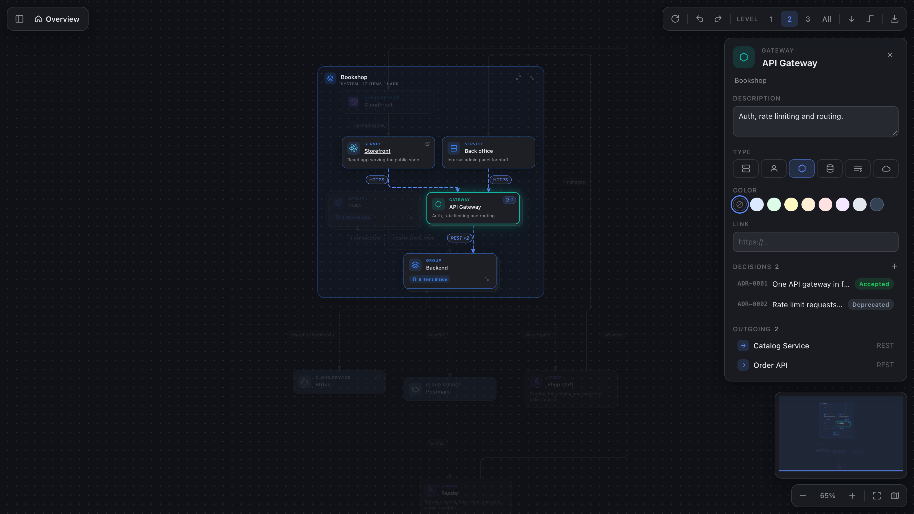
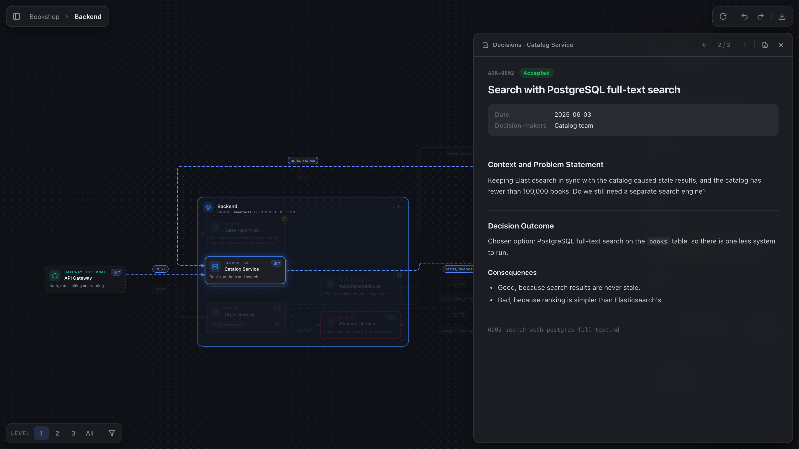

# mapitect

An interactive preview for [D2](https://d2lang.com) architecture diagrams in VS Code.

mapitect opens a `.d2` file as a map you can zoom, pan and drill into. Large diagrams start at the top level, and you expand the parts you care about. You can rename elements and change their description, link, type and color in the preview, and mapitect writes those changes back to the `.d2` file. If you keep architecture decision records in MADR format, each element also shows the decisions that belong to it.

The file is parsed by the official D2 compiler ([`@d2lang/d2`](https://www.npmjs.com/package/@d2lang/d2), the WASM build of D2), so the preview understands the same syntax as the `d2` CLI, including classes, vars, globs and imports.



## Getting started

Open a `.d2` file and press `Cmd+K V` (`Ctrl+K V` on Windows and Linux), or click the preview button in the editor title bar. The preview opens beside the editor and updates as you type. When the layout changes, elements animate to their new positions.

Compiler errors appear in the Problems panel, and the preview keeps showing the last version of the diagram that compiled.

## Finding your way around

Drag the canvas to pan. Zoom with the mouse wheel, a trackpad pinch, `+` and `-`, or the zoom bar. On a trackpad, two-finger scrolling pans instead of zooming (the `mapitect.wheel` setting changes this). `F` fits the whole diagram on screen and `1` resets the zoom to 100%.

A new preview opens at *Level 1*, which shows only the top-level elements. The *Level 1 / 2 / 3 / All* switcher in the toolbar expands deeper levels. You can also collapse or expand a single container with its corner button or with `[` and `]`. When a container is collapsed, the connections to the elements inside it are merged into one dashed connection with a combined label.

To focus on one part of the system, double-click a container. mapitect then shows only its contents, plus the outside elements it talks to as dashed context cards. It works much like moving down a level in a C4 model. The breadcrumbs, `Esc` or `Backspace` take you back up.

A few more things help with larger diagrams:

- Clicking an element highlights its connections and dims everything else. The arrow keys move the selection to the nearest element in that direction.
- The details panel shows the selected element's description (`tooltip`), link, connections and children. Every entry in it is clickable.
- The sidebar contains a tree of the whole model, with each element's children under *Components* and its decision records under *ADRs*. It starts collapsed. Open it with the button at the top left, or press `/` or `Cmd+F` to search, and `Enter` to jump to the first match.
- As you zoom out, descriptions and labels fade and group names get larger, so a big map stays readable.
- The minimap is hidden by default. Press `M` or use the map button to show it, then click or drag inside it to move around.

To save the diagram as an image, run *mapitect: Export Diagram as SVG* or *Export Diagram as PNG* from the Command Palette. The preview follows your VS Code theme, including the high-contrast themes.

## Diagram and source side by side

When you select an element or connection in the preview, its declaration is highlighted in any editor that already shows the file and scrolled into view. Your cursor stays where it is, and no new editor is opened. It also works the other way round: the element under the editor cursor is outlined in the diagram. To jump to an element's source, `Cmd+click` it (`Ctrl+click` on Windows and Linux).

You can change the highlight colors with `mapitect.sourceHighlightBackground` and `mapitect.sourceHighlightRuler` in `workbench.colorCustomizations`.

## Editing in the preview

The preview lets you change text and the look of elements. The structure stays in code, so adding, removing and reconnecting elements happens in the `.d2` file. Each change you make in the preview becomes a small edit in the source, based on the compiler's syntax tree. The rest of your formatting and your comments are left as they are.

Here is what you can edit:

- Rename an element, a group title or a connection label by double-clicking it or pressing `F2`.
- In the details panel, edit an element's name, description (`tooltip`) and link, choose its type (service, actor, gateway, data store, queue or cloud service) or set a fill color. For a connection you can edit the label. Other D2 shapes are displayed correctly, but you set them in code.
- Right-click an element or connection for *Rename* or *Edit label*, *Go to source* and navigation commands.
- The arrow button in the toolbar cycles the layout direction through right, down, left and up, and stores it as `direction:` in the file.
- `⌘Z` and `⇧⌘Z` undo and redo edits made in the preview. If you have typed in the file since, use the editor's own undo instead.

Editing is paused while the file has compile errors, because the source positions might be out of date. The layout is always automatic, so elements can't be moved by hand.

## Architecture decisions

mapitect can show [MADR](https://adr.github.io/madr/) decision records next to the elements they belong to. Add the folders that hold them to an `adr-folders` variable at the top of the `.d2` file. Paths can be relative to the `.d2` file or absolute, and you can list one folder or several:

```d2
vars: {
  adr-folders: [adr; ../shared/decisions]
}
```



Inside each folder, a component gets its own subfolder named after the element, with its ADR files in it:

```
platform.d2
adr/
  gateway/                     # matches the element whose key is "gateway"
    0001-single-api-gateway.md
    0002-rest-between-gateway-and-services.md
  shop.services.orders/        # or the element's full id
  shop/services/payments/      # or a path mirroring the diagram's nesting
../shared/decisions/
  gateway/                     # decisions from every folder are merged per element
    0001-rate-limits.md
```

Elements with decisions get a badge with the number of records, and groups show the count in their header. The details panel lists an element's decisions with number, title and status. Click a decision or a badge to open it in the decision reader, which also shows the date and the decision-makers. Use `←` and `→` to step through the component's decisions. Links between ADRs open in the reader as well.

To write a new decision, right-click an element and choose *New decision…*, or click the `+` next to *Decisions* in the details panel. mapitect asks for a title, creates the next numbered MADR file with `status: proposed` and today's date, and opens it in the editor. The file goes next to the element's existing decisions (in the first folder that has any) and gets the number after the highest one there. For an element without decisions, mapitect creates a new folder in the first `adr-folders` entry. It is named after the element's key, or after its full id if another element has the same key.

A few more details:

- mapitect reads MADR 3 and 4 YAML front matter (`status`, `date`, `decision-makers`, `consulted`, `informed`) as well as the MADR 2 bullet style (`* Status: …`). Statuses are shown as accepted, proposed, rejected, deprecated or superseded.
- The preview updates when you add or edit Markdown files or change `adr-folders`. Folders that don't match any element are listed in the sidebar footer.
- Without `adr-folders`, mapitect doesn't look for decisions at all. `README.md`, `index.md`, `template.md` and files whose names start with `.` or `_` are ignored.

The [`examples`](https://github.com/codetent/mapitect/tree/main/examples) folder in the repository has a sample diagram with 9 decisions in `adr` and `adr-shared`.

## Supported D2

mapitect supports whatever the official compiler accepts. Imports are resolved against other `.d2` files in the same folder, up to two levels deep. For now only the main board is shown. `layers`, `scenarios` and `steps` are compiled but not displayed.

mapitect lays out diagrams itself with ELK, which is what makes collapsing and drilling down possible. For that reason `width`, `height`, `top`, `left`, grid settings and the choice of D2 layout engine are ignored.

Each element type has its own icon and accent color. This covers actors (`person`), services, gateways (`hexagon`), data stores (`cylinder`), queues, cloud services, tables and a few more.

## Keyboard shortcuts

| Key | Action |
| --- | --- |
| `F2` | Rename the selection |
| `⌘Z` / `⇧⌘Z` | Undo / redo an edit made in the preview |
| `F` / `1` | Fit to screen / zoom to 100% |
| `+` `-` | Zoom in and out |
| Arrow keys | Move the selection, or pan when nothing is selected (`Shift` for bigger steps) |
| `Enter` | Expand, drill into, or open the source of the selection |
| `Esc` / `Backspace` | Clear the selection, then go up a level |
| `[` `]` | Collapse / expand the selected container |
| `/`, `Cmd+F` | Search |
| `M` | Show or hide the minimap |

## Settings

| Setting | Default | Description |
| --- | --- | --- |
| `mapitect.wheel` | `auto` | What the scroll wheel does. `auto` pans on a trackpad and zooms with a mouse wheel, `zoom` always zooms, and `pan` always pans (hold `Ctrl`/`Cmd` to zoom). |
| `mapitect.defaultDepth` | `1` | Detail level a new preview opens at. `0` expands everything. |
| `mapitect.syncSelection` | `true` | Outline the element under the editor cursor in the diagram. |
